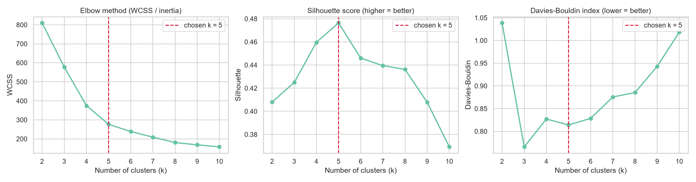
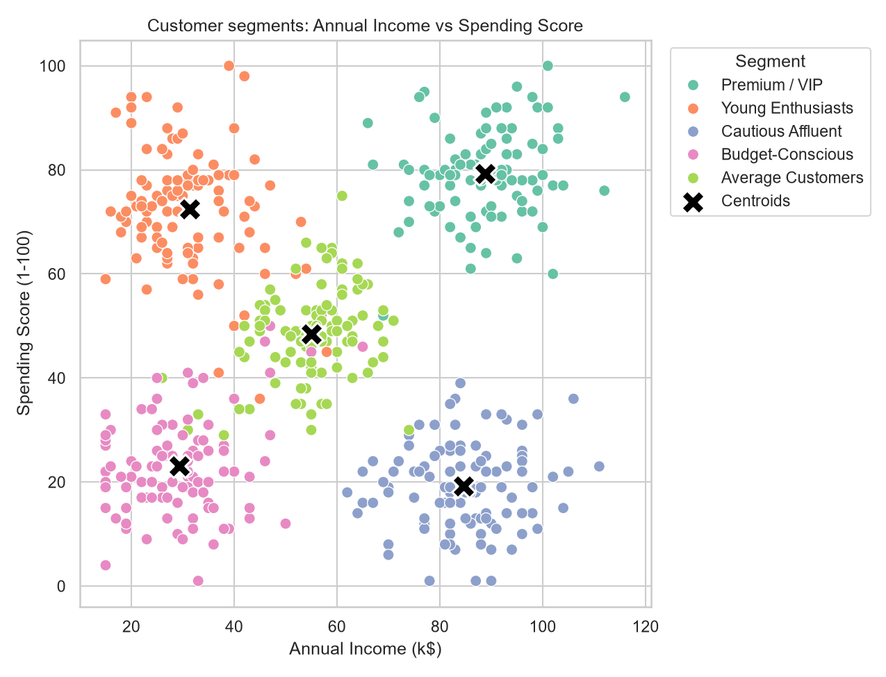
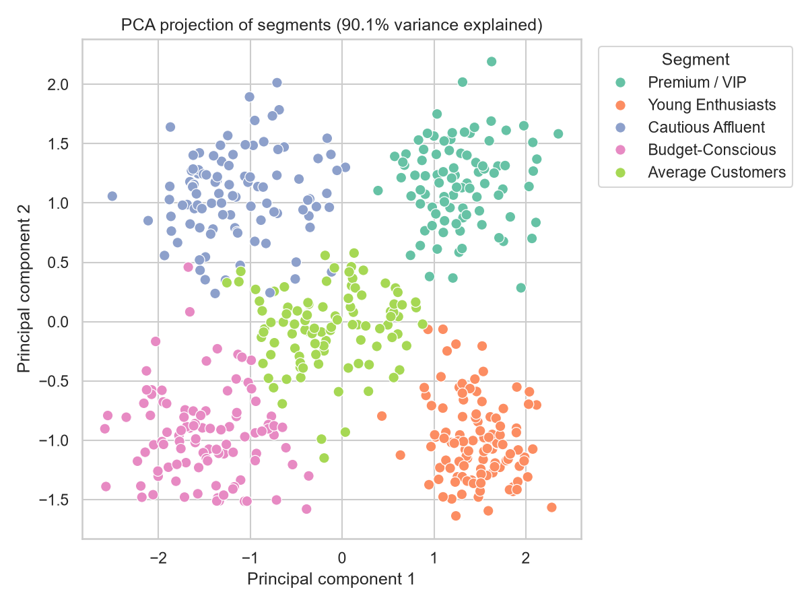
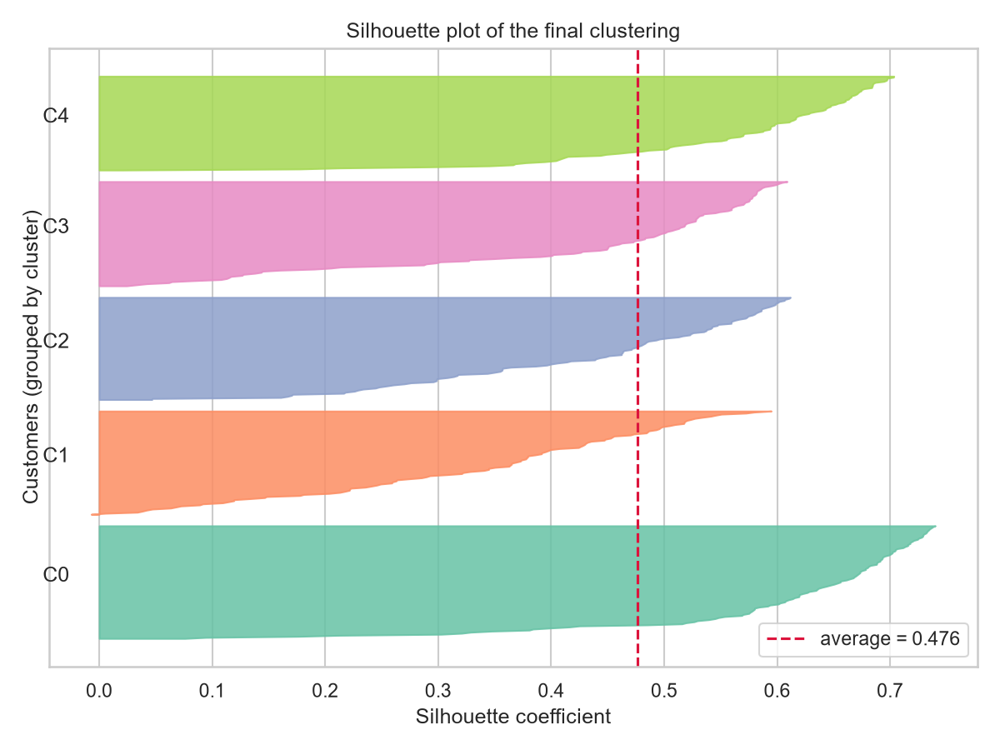
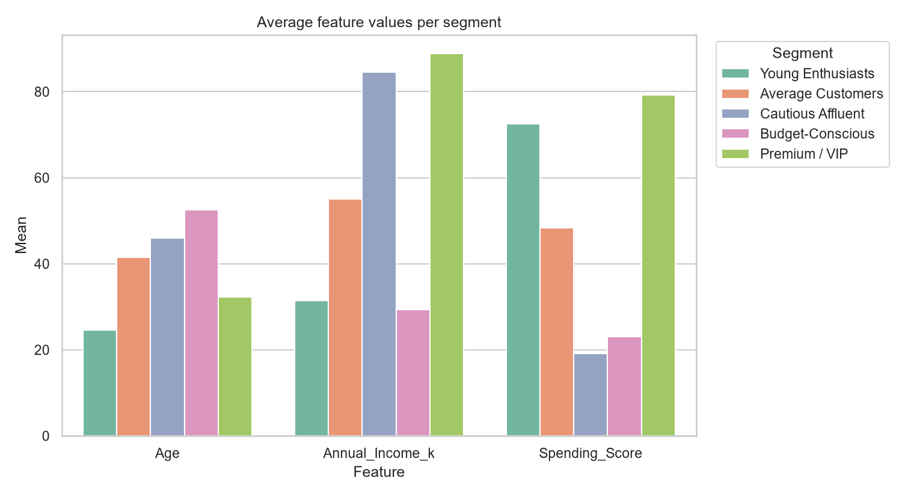
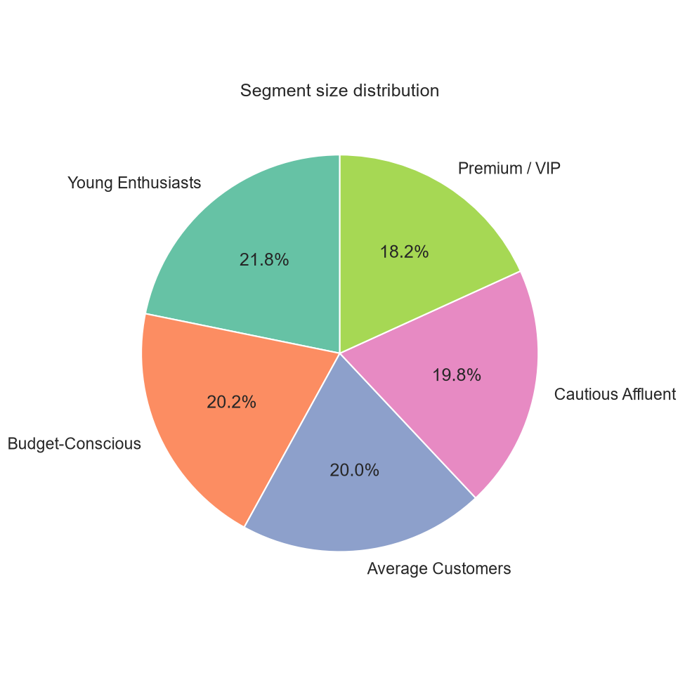

# Customer Segmentation Using K-Means Clustering


Data Mining mini-project: grouping retail customers into meaningful segments with **K-Means clustering**, so a business can design targeted marketing strategies instead of treating every customer the same way.

**Author:** Mamadou Yassne Diallo ([@Diallo-Dev27](https://github.com/Diallo-Dev27))
**Program:** B.Sc. Computer Science , Chandigarh University
**Course:** Data Mining-Lab

---

## Table of Contents
1. [Problem Statement](#1-problem-statement)
2. [Dataset](#2-dataset)
3. [Methodology](#3-methodology)
4. [Results](#4-results)
5. [Business Interpretation](#5-business-interpretation)
6. [Limitations](#6-limitations)
7. [Project Structure](#7-project-structure)
8. [How to Run](#8-how-to-run)
9. [Future Work](#9-future-work)
10. [References](#10-references)

---

## 1. Problem Statement
Customers differ in income, age and buying behavior. Mass marketing wastes budget; **customer segmentation** divides the customer base into homogeneous groups so each can be targeted with the right offer.

**Objectives**
- Explore and understand the customer data.
- Prepare the data correctly for a distance-based algorithm.
- Determine the optimal number of clusters *k* with several complementary criteria.
- Build, evaluate and interpret the K-Means model.
- Translate clusters into actionable business recommendations.

## 2. Dataset
A **synthetic dataset of 500 customers** is generated by `data/generate_dataset.py` (fixed seed, fully reproducible). It follows the structure of the popular *Mall Customers* dataset. It is built from five hidden customer profiles that the algorithm is **not told about**, so we can check whether K-Means rediscovers them.

| Feature | Type | Description |
|---|---|---|
| `CustomerID` | integer | Unique identifier (not used for clustering) |
| `Gender` | categorical | Male / Female (used for profiling only) |
| `Age` | integer | 18 to 70 years |
| `Annual_Income_k` | integer | Annual income in thousands of dollars |
| `Spending_Score` | integer | 1 to 100, assigned by the store from purchasing behavior |

**Clustering features:** `Age`, `Annual_Income_k`, `Spending_Score`.
No missing values and no duplicate IDs.

> Want to use real data? Put any CSV with the same columns in `data/` and run `python src/segmentation.py --data data/your_file.csv`.

## 3. Methodology

| Step | What was done | Why |
|---|---|---|
| **1. EDA** | Distributions, descriptive statistics, correlation matrix, gender split | Understand ranges, skewness and relationships |
| **2. Preprocessing** | `StandardScaler` (mean 0, std 1) | K-Means uses Euclidean distance; unscaled features with larger ranges (income) would dominate |
| **3. Choosing k** | Elbow (WCSS), Silhouette, Davies-Bouldin, Calinski-Harabasz for k = 2..10 | No single metric is reliable alone |
| **4. Model** | `KMeans(n_init=20, random_state=42)` with k-means++ initialization | Stable, reproducible result |
| **5. Profiling** | Mean of each feature per cluster in original units, size, gender mix | Make clusters interpretable |
| **6. Visualization** | 2D scatter with centroids, PCA projection, silhouette plot, profile bars | Validate and communicate results |

### How K-Means works
1. Choose *k* and initialize *k* centroids (k-means++).
2. **Assign** every customer to the nearest centroid.
3. **Update** each centroid to the mean of its assigned customers.
4. Repeat steps 2 and 3 until assignments stop changing.

The algorithm minimizes the within-cluster sum of squares:

`WCSS = sum over clusters j of sum over x in C_j of ||x - mu_j||^2`

## 4. Results

### 4.1 Choosing the number of clusters

| k | WCSS | Silhouette | Davies-Bouldin | Calinski-Harabasz |
|--:|--:|--:|--:|--:|
| 2 | 810.15 | 0.408 | 1.039 | 424.1 |
| 3 | 577.40 | 0.425 | **0.766** | 397.1 |
| 4 | 374.93 | 0.460 | 0.827 | 496.1 |
| **5** | 276.68 | **0.476** | 0.814 | **547.1** |
| 6 | 238.57 | 0.446 | 0.828 | 522.4 |
| 7 | 209.08 | 0.440 | 0.876 | 507.3 |
| 8 | 180.68 | 0.436 | 0.885 | 513.2 |
| 9 | 168.58 | 0.408 | 0.943 | 484.7 |
| 10 | 157.78 | 0.369 | 1.019 | 463.1 |

**k = 5** is selected: it has the highest Silhouette and Calinski-Harabasz scores, and the elbow in the WCSS curve flattens after 5. Davies-Bouldin is slightly lower at k = 3, which shows that metrics can disagree; the business interpretability of five segments tipped the decision.



### 4.2 Final model quality

| Metric | Value | Reading |
|---|--:|---|
| Silhouette | 0.476 | Reasonable structure (above 0.25 is generally considered meaningful) |
| Davies-Bouldin | 0.814 | Low, clusters are fairly well separated |
| Calinski-Harabasz | 547.1 | High, compact and distinct clusters |
| PCA 2D variance explained | 90.1% | The 2D projection is a faithful view of the data |

### 4.3 Customer segments

| Cluster | Segment | Avg. age | Avg. income (k$) | Avg. spending score | Customers | Share |
|--:|---|--:|--:|--:|--:|--:|
| 0 | Young Enthusiasts | 24.6 | 31.4 | 72.5 | 109 | 21.8% |
| 1 | Average Customers | 41.5 | 55.0 | 48.4 | 100 | 20.0% |
| 2 | Cautious Affluent | 46.0 | 84.6 | 19.2 | 99 | 19.8% |
| 3 | Budget-Conscious | 52.6 | 29.3 | 23.1 | 101 | 20.2% |
| 4 | Premium / VIP | 32.3 | 88.8 | 79.2 | 91 | 18.2% |



| | |
|---|---|
|  |  |
|  |  |

Additional EDA figures: [distributions](outputs/figures/01_distributions.png), [correlation](outputs/figures/02_correlation.png), [gender](outputs/figures/03_gender.png).

## 5. Business Interpretation

| Segment | Profile | Recommended strategy |
|---|---|---|
| **Premium / VIP** | High income, high spending, around 32 years old | Loyalty program, early access to new collections, personalized service. Protect and grow this group. |
| **Young Enthusiasts** | Low income, high spending, around 25 years old | Social-media campaigns, trendy products, installment plans, student discounts. |
| **Cautious Affluent** | High income, low spending | Highest untapped potential: premium and quality-focused offers, exclusive events, targeted surveys to understand why they spend little. |
| **Average Customers** | Mid income, mid spending | Bundles, seasonal promotions, upselling to move them toward the VIP group. |
| **Budget-Conscious** | Low income, low spending, oldest group | Value packs, discounts, low-cost retention. Avoid expensive campaigns. |

## 6. Limitations
- The dataset is **synthetic** with deliberately well-separated groups, so real-world data will give less clean clusters and lower scores.
- K-Means assumes **roughly spherical clusters of similar size** and is sensitive to outliers and to the choice of *k*.
- Only three numeric features are used; real segmentation would add purchase frequency, recency, basket value, product categories, etc.
- Segment names are assigned by simple rules on cluster averages and should be validated by domain experts.
- Gender is used only for profiling, not for clustering.

## 7. Project Structure
```
customer-segmentation-kmeans/
├── data/
│   ├── generate_dataset.py      # reproducible synthetic data generator
│   └── customers.csv            # generated dataset (500 customers)
├── src/
│   └── segmentation.py          # full pipeline: EDA -> k selection -> model -> plots
├── outputs/
│   ├── figures/                 # 9 charts used in this README
│   ├── customers_segmented.csv  # every customer with cluster + segment
│   ├── cluster_profiles.csv     # per-cluster statistics
│   ├── k_selection_metrics.csv  # metrics for k = 2..10
│   └── final_metrics.csv        # final model scores
├── requirements.txt
├── LICENSE
└── README.md
```

## 8. How to Run
```bash
# 1. Clone and enter the project
git clone https://github.com/Diallo-Dev27/customer-segmentation-kmeans.git
cd customer-segmentation-kmeans

# 2. (Recommended) create a virtual environment
python -m venv .venv
source .venv/bin/activate          # Windows: .venv\Scripts\activate

# 3. Install dependencies
pip install -r requirements.txt

# 4. (Optional) regenerate the dataset
python data/generate_dataset.py

# 5. Run the full pipeline
python src/segmentation.py


**Useful options**
```bash
python src/segmentation.py --k 4                  # force a number of clusters
python src/segmentation.py --max-k 12             # search a wider range of k
python src/segmentation.py --features Annual_Income_k Spending_Score   # 2 features only
python src/segmentation.py --data data/my_data.csv
```

## 9. Future Work
- Compare with **Hierarchical clustering**, **DBSCAN** and **Gaussian Mixture Models**.
- Test on the real *Mall Customers* dataset or an RFM (Recency, Frequency, Monetary) dataset.
- Add a Streamlit dashboard to explore segments interactively.
- Predict the segment of a new customer with a classifier trained on the cluster labels.


## License
Released under the [MIT License](LICENSE).
